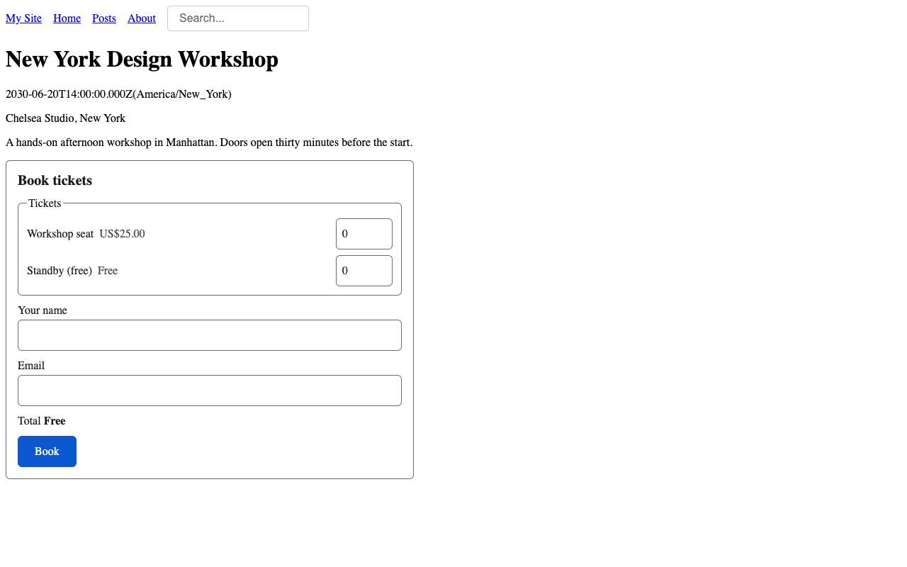
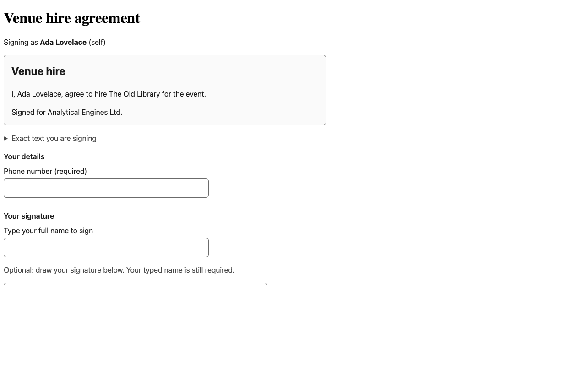

# semics plugins for EmDash

Two plugins for [EmDash CMS](https://emdashcms.com), and a small package that links them.

- **semics Events** (`@semics-tech/emdash-events`, plugin `semics-events`): events from your own content,
  ticket types, capacity, bookings, a waitlist, confirmation emails, calendar files and check-in.
- **semics E-sign** (`@semics-tech/emdash-esign`, plugin `semics-esign`): Markdown templates, one signer per
  envelope, a typed name with an optional drawn signature, a hash-chained audit trail, a signed PDF with a certificate, and a
  public page that checks a signed PDF.
- **Events suite** (`@semics-tech/emdash-events-suite`): wires the two together for event waivers.

The Free editions are MIT licensed. Pro builds of the same plugins add paid tickets, waivers, QR passes,
several signers and more. See [Free and Pro](editions.md).

## How the plugins are built

Each product has two halves:

- a **sandboxed core** that holds every rule and all data. EmDash runs it in an isolated worker with only
  the permissions its manifest asks for. This is the part the plugin registry can install.
- a **UI kit**: Astro components, a few pages the plugin adds to your site, and an Astro integration. It
  talks to the core only through the core's public routes. The registry cannot deliver this half, so you
  install it from npm.

The cores never call each other. The suite connects them through their public routes.

## Where to start

1. [Install](install.md) the packages and add them to `astro.config.mjs`.
2. [Configure](configure.md) secrets, email, the site URL, Turnstile and proxy headers.
3. Read the guide for what you run: [Events](events.md), [E-sign](esign.md), [waivers](waivers.md).
4. Put the [pages and components](site-pages.md) on your site.

Before you go live, read [Data and retention](privacy.md) and [Troubleshooting](troubleshooting.md).

## Requirements

- EmDash 1.2 (the plugins are tested against 1.2.0) on Astro, with a sandbox runner. The examples use
  `@emdash-cms/sandbox-workerd`; on Cloudflare Workers use EmDash's Worker Loader sandbox.
- Node 24.15 or newer for local builds.
- An EmDash email provider, if you want the plugins to send email.

## Screenshots

